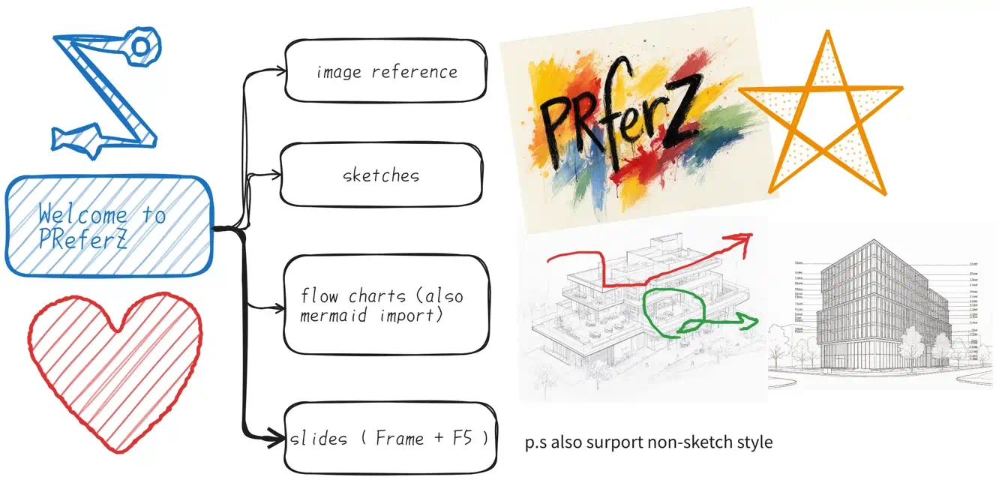

# PReferZ


[中文readme](#chinese)

A minimalist reference image aggregator desktop app written in Rust. Infinite canvas, pan/zoom, image import, Excalidraw-style hand-drawn shapes, freehand ink, text notes, flowcharts, charts, frame slides, undo/redo, and `.prz` project save/load. Also ships a headless CLI (`--headless` / `--exec`) and an MCP server (`--mcp`) so AI agents can drive the canvas.

For design / architecture details (crate layout, data models, phases), see [`.agents/specs/preferz-spec.md`](./.agents/specs/preferz-spec.md). Roadmap & delivery archive: [`.agents/plan.md`](./.agents/plan.md) / [`.agents/CHANGELOG.md`](./.agents/CHANGELOG.md).

---

### Install

The easiest way: grab a prebuilt binary from [GitHub Releases](https://github.com/Feihei/PReferZ/releases) and run it — no dependencies, no install steps.

Or build from source (Rust stable >= 1.88):

```bash
cargo run -p preferz             # run the app
cargo check --workspace          # fast type check
cargo test --workspace           # unit tests
cargo build --release -p preferz # release binary
```

The binary is multi-mode (Blender-style): no args / a `.prz` path opens the GUI; `--mcp` / `--exec` / `--headless` run headless.

### Tech Stack

- **Rust** (stable, >= 1.88)
- **GUI**: `egui` + `eframe` 0.36 (glow backend)
- **2D geometry**: `euclid`
- **File I/O**: `rusqlite` (`.prz` = SQLite + sqlar), `image`
- **Utilities**: `rfd` (file dialogs), `arboard` (clipboard), `serde_json`
- **Fonts**: built-in Source Han Sans CN + 851 handwriting font (GB2312+ASCII subset), deflate-compressed into the binary at build time

### Features

- Infinite canvas: pan (middle-drag), zoom at cursor (10%–1000%), box-select
- Images: import (drag & drop / file dialog / paste), crop, rotate & scale handles, opacity, grayscale, eyedropper
- Hand-drawn-style shapes: rectangle / ellipse / diamond / line / arrow / polygon / frame, hachure & semi-transparent fills, sloppiness levels, line endpoints snap to shape edges
- Freehand ink with velocity-tapered strokes (Catmull-Rom smoothing)
- Text notes — standalone or bound to shapes; sans + handwriting fonts, H/V alignment
- Flowcharts: `Ctrl+Arrows` clones a connected node, `Alt+Arrows` navigates along connections; import mermaid flowcharts (right-click menu)
- Charts: paste two-column spreadsheet data → bar / line chart
- Align (6-way) / distribute (gap / centers) / arrange (linear, grid, optimal packing); group & ungroup; z-order (move forward/backward, bring to front/send to back)
- Frame slides presentation (`F5`) with aspect-ratio / paper presets
- Autosave (`.prz.autosave`) with restore prompt; every edit goes through undo/redo
- Built-in help document (the `?` button at the bottom-left) — an editable sandbox canvas listing every shortcut and interaction
- Dark / Light / Auto themes, English / 中文 UI
- Always-on-top / frameless / background-transparent floating-board mode
- Headless CLI & MCP server: `preferz --mcp` runs a stdio MCP server that proxies to a running GUI window (tools operate the opened canvas live), or falls back to headless mode; `--headless` / `--exec` provide a JSONL protocol for scripts and agents

### Basic Usage

Pan with middle-drag, zoom with the scroll wheel, double-click empty canvas for a text note, right-click for the full context menu.

For the complete list of mouse interactions and keyboard shortcuts, click the **`?`** button at the bottom-left of the canvas — it opens the built-in help document, a live canvas where every shortcut is listed (and which you can freely scribble on; changes are not saved).

### Autosave

While an opened `.prz` has unsaved changes, a silent backup `foo.prz.autosave` is written next to it after the idle interval (default 30 s, configurable 10–300 s). Reopening the original file offers to restore the newer backup; manual `Ctrl+S` semantics are unchanged.

### Settings

The in-app settings panel covers the default style toggle (Sketch — hand-drawn strokes at medium sloppiness + handwriting font, the factory default; Clean — precise lines + sans-serif), arrange spacing, always-on-top / frameless / background transparency, autosave (toggle + interval), default frame aspect ratio, UI language, and theme (Dark / Light / Auto).

Welcome page lists recent projects (persisted at `~/.preferz/recent.json`, up to 10 entries).

### CLI & MCP

The same binary doubles as a headless interface for scripts and AI agents (Blender-style multi-mode):

```bash
preferz --mcp                    # MCP stdio server (JSON-RPC 2.0)
preferz --headless board.prz     # JSONL REPL on stdin/stdout, one JSON request per line
preferz --exec '{"cmd":"add_shape","shape":"rect","x":0,"y":0,"w":10,"h":10}' board.prz
```

- **`--mcp` is a proxy bridge**: if a PReferZ GUI window is already open, the MCP server attaches to it and every tool call operates the opened canvas in real time (rendered as you watch); with no GUI running it falls back to a headless single-document server.
- 15 tools mirror the JSONL commands one-to-one (`open` / `save` / `list` / `add_shape` / `add_text` / `add_mermaid` / `add_chart` / `move` / `undo` / …), all sharing the same undo channel.
- Dual-stack MCP: speaks both the stateless 2026-07-28 spec and the legacy `initialize` handshake (≤ 2025-11-25).

Run `preferz --help` for the full protocol reference.

### Acknowledgements

PReferZ's design and rendering take inspiration from two excellent open-source projects:

- [BeeRef](https://github.com/rbreu/beeRef) — the reference-image aggregator concept that PReferZ builds on (`.prz` is PReferZ's own format and is not compatible with BeeRef's `.bee`)
- [Excalidraw](https://github.com/excalidraw/excalidraw) — the hand-drawn style, rough.js-like stroke rendering, and the canvas-UX patterns it popularized

### License

MIT. Bundled fonts: Source Han Sans CN (SIL OFL 1.1) and the 851 handwriting font (free for commercial use) — see [`assets/FONT_LICENSES.md`](./assets/FONT_LICENSES.md).

---

<a id="chinese"></a>

## PReferZ

Picture Reference Z - 一个用 Rust 编写的极简参考图聚合桌面应用。无限画布，平移/缩放，图片导入，Excalidraw 风格手绘图形，徒手笔迹，文本便签，流程图，图表，画框演示，撤销/重做，`.prz` 工程存档。同时内置无头 CLI（`--headless` / `--exec`）与 MCP 服务器（`--mcp`），可让 AI agent 直接操作画布。

设计与架构细节（Crate 划分、数据模型、阶段计划）见 [`.agents/specs/preferz-spec.md`](./.agents/specs/preferz-spec.md)；路线图与交付归档见 [`.agents/plan.md`](./.agents/plan.md) / [`.agents/CHANGELOG.md`](./.agents/CHANGELOG.md)。

### 安装

最简单的方式：从 [GitHub Releases](https://github.com/Feihei/PReferZ/releases) 直接下载对应平台的二进制运行即可——无依赖、无需安装步骤。

也可以从源码构建（Rust stable >= 1.88）：

```bash
cargo run -p preferz             # 运行应用
cargo check --workspace          # 快速类型检查
cargo test --workspace           # 单元测试
cargo build --release -p preferz # 构建发布版本
```

二进制为单文件多模式（Blender 式）：无参数或跟 `.prz` 路径打开 GUI；`--mcp` / `--exec` / `--headless` 进入无头模式。

### 技术栈

- **Rust** (stable, >= 1.88)
- **GUI**: `egui` + `eframe` 0.36 (glow 后端)
- **2D geometry**: `euclid`
- **File I/O**: `rusqlite` (`.prz` = SQLite + sqlar), `image`
- **工具库**: `rfd`（文件对话框）, `arboard`（剪贴板）, `serde_json`
- **字体**: 内置思源黑体 + 851 手写体（GB2312+ASCII 子集），构建期 deflate 压缩嵌入二进制

### 功能特性

- 无限画布：中键平移、光标处缩放（10%–1000%）、框选
- 图片：导入（拖放 / 对话框 / 粘贴）、裁剪、旋转与缩放手柄、不透明度、灰度、取色器
- 手绘风图形：矩形 / 椭圆 / 菱形 / 直线 / 箭头 / 多边形 / 画框，斜线填充与半透明填充，手绘档位，线段端点吸附图形边缘
- 徒手笔迹：按运笔速度锥形变宽（Catmull-Rom 平滑）
- 文本便签：独立或绑定图形；黑体 + 手写体，水平/垂直对齐
- 流程图：`Ctrl+方向` 克隆连接节点、`Alt+方向` 沿连接导航；右键菜单导入 mermaid 流程图
- 图表：粘贴两列表格数据 → 柱状 / 折线图
- 对齐（6 向）/ 分布（等距 / 等心）/ 排列（线形、网格、最优装箱）；编组与解组；叠放顺序（上移/下移一层、置顶/置底）
- 画框幻灯片演示（`F5`），比例 / 纸张预设
- 自动保存（`.prz.autosave`）与恢复提示；所有编辑均可撤销/重做
- 内置帮助文档（画布左下角 `?` 按钮）——一张可随意涂改的沙箱画布，完整列出所有快捷键与交互
- 深色 / 浅色 / 跟随系统主题，中英双语界面
- 窗口置顶 / 无边框 / 背景透明的悬浮看图板模式
- 无头 CLI 与 MCP 服务器：`preferz --mcp` 启动 stdio MCP 服务器，GUI 已打开时自动代理（工具实时操作当前画布窗口），无 GUI 时降级为无头模式；`--headless` / `--exec` 提供面向脚本与 agent 的 JSONL 协议

### 基本用法

中键拖拽平移、滚轮缩放、双击空白处新建文本便签、右键打开完整上下文菜单。

完整的鼠标交互与键盘快捷键列表，请点击画布左下角的 **`?`** 按钮打开内置帮助文档——它本身就是一张画布，所有快捷键都列在上面，还可以随意涂改试用（改动不会被保存）。

### 自动保存

打开的 `.prz` 有未保存改动时，静置超过间隔（默认 30 秒，可调 10–300 秒）即在同目录静默写 `foo.prz.autosave` 备份；重新打开原文件时若备份更新会提示恢复。手动 `Ctrl+S` 语义不变。

### 设置

应用内设置面板提供：默认风格总开关（草绘——手绘抖动中档 + 手写字体，出厂默认；规整——精确线条 + 黑体）、排列间距、窗口置顶 / 无边框 / 背景不透明度、自动保存（开关 + 间隔）、新建画框默认比例、界面语言、主题（深色 / 浅色 / 跟随系统）。

欢迎页会列出最近打开的工程（持久化于 `~/.preferz/recent.json`，最多 10 项）。

### CLI 与 MCP

同一个二进制兼作面向脚本与 AI agent 的无头接口（Blender 式多模式）：

```bash
preferz --mcp                    # MCP stdio 服务器（JSON-RPC 2.0）
preferz --headless board.prz     # stdin/stdout 的 JSONL 会话，每行一个 JSON 请求
preferz --exec '{"cmd":"add_shape","shape":"rect","x":0,"y":0,"w":10,"h":10}' board.prz
```

- **`--mcp` 是代理桥**：若已有 PReferZ GUI 窗口打开，MCP 服务器会挂到该实例上，每次工具调用都实时操作当前画布（边调边渲染）；无 GUI 运行时降级为无头单文档服务器。
- 15 个工具与 JSONL 命令一一对应（`open` / `save` / `list` / `add_shape` / `add_text` / `add_mermaid` / `add_chart` / `move` / `undo` 等），共享同一 undo 通道。
- MCP 双栈协议：同时支持 2026-07-28 最新无状态规范与旧版 `initialize` 握手（≤ 2025-11-25）。

完整协议说明运行 `preferz --help` 查看。

### 致谢

PReferZ 的设计与渲染大量参考了两个优秀的开源项目：

- [BeeRef](https://github.com/rbreu/beeRef) —— PReferZ 所做的参考图聚合这一产品形态的源头（`.prz` 是 PReferZ 自己的格式，与 BeeRef 的 `.bee` 不兼容）
- [Excalidraw](https://github.com/excalidraw/excalidraw) —— 手绘风格、rough.js 式笔画渲染以及广为流行的画布交互范式

### 许可

MIT。内置字体：思源黑体（SIL OFL 1.1）、851 手写字体（免费商用）——详见 [`assets/FONT_LICENSES.md`](./assets/FONT_LICENSES.md)。
